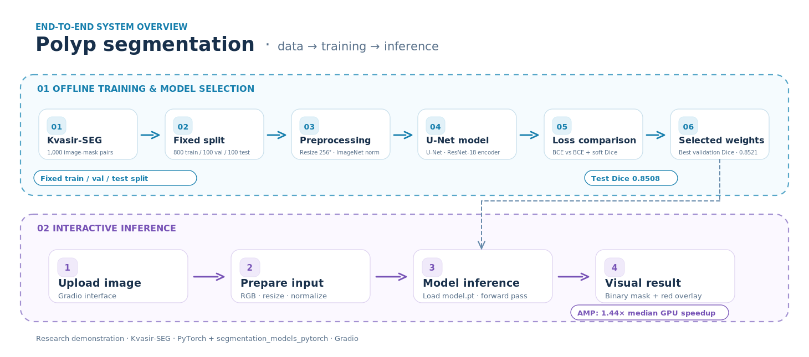
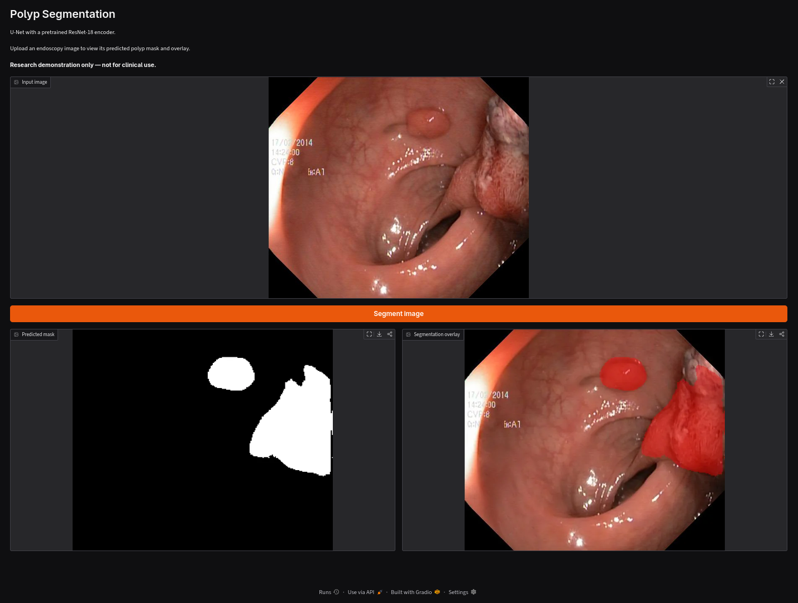
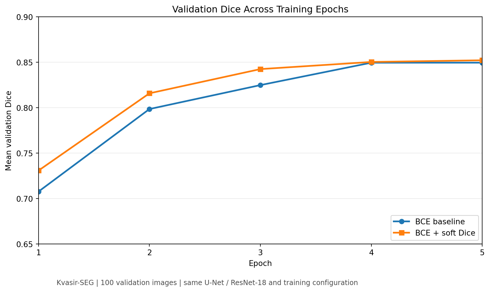
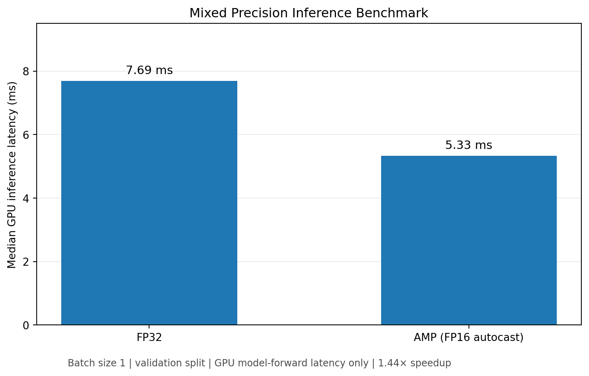

# Polyp Segmentation with U-Net

Binary segmentation of gastrointestinal polyps from endoscopic images using **PyTorch**, **U-Net**, and a pretrained **ResNet-18 encoder**.

## System Overview



The pipeline consists of two main stages:
model training and selection, followed by
interactive inference with Gradio.

This project implements an end-to-end computer vision pipeline covering dataset preprocessing, model training, controlled experiments, evaluation, inference optimization, and deployment through a Gradio interface.

The model was trained on the **Kvasir-SEG** dataset and predicts pixel-level segmentation masks identifying polyp regions.

**Disclaimer:** This is a research and educational project. It is not validated for medical diagnosis or clinical use.

## Results

| Metric | Result |
|---|---:|
| Held-out test Dice | **0.8508** |
| Held-out test IoU | **0.7642** |
| Best validation Dice | **0.8521** |
| Best validation IoU | **0.7675** |
| Median GPU inference speedup with mixed precision | **1.44×** |

The selected model uses a combined Binary Cross-Entropy and soft Dice loss.

**For detailed methodology, experiments, limitations,
and engineering decisions, see the
[Technical Report](reports/technical_report.md).**

## Demo



## Application

A Gradio application allows users to upload an endoscopic image and obtain:

- A predicted binary polyp mask.
- A segmentation overlay highlighting the predicted polyp region.

The application supports local CPU or CUDA inference.

Run the app using:

`python app.py`

## Dataset

The project uses [Kvasir-SEG](https://datasets.simula.no/kvasir-seg/), a dataset containing 1,000 endoscopic polyp images and their corresponding segmentation masks.

The data was divided using a deterministic random split with seed 42:

| Split | Images |
|---|---:|
| Training | 800 |
| Validation | 100 |
| Test | 100 |
| Total | 1,000 |

The file `configs/splits.json` stores the exact filenames used in each split.

The test set was reserved for the final evaluation and was not used to select the model or tune the optimization.

### Preprocessing

- Resize input images to 256 × 256 using bilinear interpolation.
- Resize segmentation masks with nearest-neighbor interpolation.
- Convert input images to RGB and scale pixel values to [0, 1].
- Apply ImageNet mean and standard deviation normalization to the model inputs.
- Convert ground-truth masks into binary foreground/background labels.

The same image normalization is applied during training, validation, testing, and inference.

### Dataset setup

Download the dataset from the [official Kvasir-SEG website](https://datasets.simula.no/kvasir-seg/).

Extract its images and masks into the following structure:

    data/
    └── Kvasir-SEG/
        ├── images/
        │   ├── image1.jpg
        │   └── ...
        └── masks/
            ├── image1.jpg
            └── ...

Images and masks are paired using their filenames.

The full dataset is not included in this repository.

## Model architecture

The model is a U-Net for binary semantic segmentation, implemented using `segmentation_models_pytorch`.

| Component | Configuration |
|---|---|
| Architecture | U-Net |
| Encoder | ResNet-18 |
| Encoder initialization | ImageNet pretrained weights |
| Input | RGB image, 256 × 256 |
| Output | Single-channel segmentation logits |
| Optimizer | Adam |
| Learning rate | 0.0001 |
| Batch size | 8 |
| Training epochs | 5 |
| Random seed | 42 |

The pretrained encoder provides reusable visual features, while the U-Net decoder produces dense pixel-level predictions.

The model outputs logits. A threshold of zero on these logits is equivalent to a probability threshold of 0.5 after sigmoid activation.

## Training experiments

Two configurations were evaluated under the same data split, model architecture, optimizer, learning rate, batch size, and training duration.

### Experiment 1 — BCE baseline

The baseline used `BCEWithLogitsLoss`, a pixel-wise binary classification loss.

### Experiment 2 — BCE + Dice

The second experiment used a combined objective:

**Total loss = BCE loss + soft Dice loss**

The Dice component encourages overlap between predicted foreground regions and ground-truth segmentation masks.

Soft Dice is calculated using continuous sigmoid probabilities so that gradients can propagate during training.

### Experimental comparison

| Metric | BCE baseline | BCE + Dice |
|---|---:|---:|
| Best validation Dice | 0.8495 | **0.8521** |
| Validation IoU at selected checkpoint | 0.7637 | **0.7675** |
| Epochs | 5 | 5 |



The combined-loss experiment achieved a slightly higher validation Dice and IoU and was selected for final evaluation.

The improvement was modest, approximately 0.26 percentage points in Dice. These results come from one seeded training run per configuration and do not establish that one loss formulation is universally superior.

The absolute training losses of the two experiments should not be directly compared because they use different objective functions.

Experiment histories are provided in:

- `results/baseline_metrics.csv`
- `results/bce_dice_metrics.csv`

## Held-out test evaluation

The selected BCE + Dice checkpoint was evaluated on 100 held-out test images.

| Metric | Score |
|---|---:|
| Mean Dice | **0.8508** |
| Mean IoU | **0.7642** |

Dice and Intersection over Union (IoU) were computed per image and averaged across the test set.

Per-image results are available in `results/test_metrics.csv`.

### Qualitative error analysis

The five lowest-Dice test predictions were inspected visually.

The observed failure patterns included:

- Partial segmentation of the actual polyp region.
- False-positive foreground predictions in surrounding tissue.
- Difficult viewing angles.
- Low visual distinction between polyp tissue and adjacent tissue.

These observations suggest that appearance variability and ambiguous boundaries remain challenges. They do not establish the underlying causes of individual errors.

The generated comparison figure is available as `results/worst_predictions.png`, where included.

## Inference optimization

An inference optimization experiment compared standard FP32 execution with PyTorch automatic mixed precision (FP16 autocasting) on a CUDA GPU.

Both configurations used the same trained model, input resolution, and validation dataset.

The benchmark measured GPU model-forward latency using CUDA events, with GPU warm-up and synchronization.

| Measurement | FP32 | Mixed precision |
|---|---:|---:|
| Mean latency | 7.919 ms | **5.469 ms** |
| Median latency | 7.692 ms | **5.334 ms** |
| Validation Dice | 0.85214 | 0.85216 |
| Validation IoU | 0.76751 | 0.76753 |



Mixed precision achieved a **1.44× median inference speedup**, corresponding to approximately a **30.6% reduction in median latency**.

The observed accuracy differences were negligible. The benchmark does not demonstrate improved segmentation accuracy from mixed precision.

Measurements were performed on a CUDA-enabled Google Colab runtime with batch size 1. The timing excludes data loading, CPU preprocessing, transfers to the GPU, and web-application overhead. Performance may differ across hardware and software environments.

The measurements are stored in `results/optimization.csv`.

## Repository structure

    polyp-segmentation/
    ├── app.py
    ├── README.md
    ├── requirements.txt
    ├── AI-USAGE.md
    ├── configs/
    │   └── splits.json
    ├── src/
    │   ├── dataset.py
    │   ├── split_data.py
    │   ├── losses.py
    │   ├── train.py
    │   ├── train_bce_dice.py
    │   ├── evaluate.py
    │   ├── benchmark.py
    │   └── inference.py
    ├── tests/
    │   ├── explore.py
    │   ├── test_dataset.py
    │   └── test_model.py
    ├── notebooks/
    │   ├── experiments_reproducible.ipynb
    │   └── experiments.ipynb
    ├── results/
    │   ├── baseline_metrics.csv
    │   ├── bce_dice_metrics.csv
    │   ├── test_metrics.csv
    │   ├── optimization.csv
    │   ├── gradio_example.png
    │   └── worst_predictions.png
    ├── assets/
    │   ├── gradio_example.png
    │   └── polyp_pipeline.png
    └── reports/
        └── technical_report.md

The following directories are used locally and are excluded from Git:

- `data/` — the Kvasir-SEG dataset.
- `weights/` — inference-only model parameters.
- `checkpoints/` — saved training checkpoints.

## Installation

Python 3.11 or 3.12 is recommended with compatible PyTorch dependencies.
```
# Clone the repository
git clone https://github.com/nikolozue93/polyp-segmentation.git
cd polyp-segmentation

# Create and activate a virtual environment
python3 -m venv .venv
source .venv/bin/activate

# Install dependencies
python -m pip install -r requirements.txt

# Download trained model weights
mkdir -p weights

curl -fL \
  https://github.com/nikolozue93/polyp-segmentation/releases/download/v1.0.0/model.pt \
  -o weights/model.pt

# Launch the application
python app.py
```
Open the local address printed by Gradio, typically:

`http://127.0.0.1:7860`

Upload an endoscopic image and select **Segment image** to produce the binary segmentation mask and overlay.

The application uses the same input normalization as the trained model.

## Reproducing the experiments

For training, download Kvasir-SEG and arrange its image and mask folders as described above.

Use the committed `configs/splits.json` to reproduce the original train/validation/test partition.

From the repository root:

**BCE baseline**

    python -m src.train

**BCE + Dice experiment**

    python -m src.train_bce_dice

**Held-out evaluation**

    python -m src.evaluate

**Inference benchmark**

    python -m src.benchmark

Training produces checkpoint files under `checkpoints/` and metrics under `results/`.

The evaluation and benchmark scripts use full training checkpoints generated by the training scripts. The separately released `model.pt` is intended for application inference.

Running the training scripts again starts new experiments and may overwrite locally generated checkpoints and metrics. Save existing experimental artifacts before rerunning them.

The original Colab workflow and exploratory executions are provided in `notebooks/experiments.ipynb`. The notebook includes Colab-specific setup instructions and paths.

## Tests

The repository contains smoke tests for the dataset pipeline and model interface.

From the project root:

    python -m tests.test_dataset
    python -m tests.test_model

The dataset test requires Kvasir-SEG to be downloaded into the expected local directory.

These scripts verify basic functionality and tensor shapes; they are not an exhaustive automated testing suite.

## Limitations and future work

This project has several limitations:

- Training and evaluation were performed on a single dataset with one deterministic split.
- There was no external-dataset validation.
- Each loss configuration was trained once, so run-to-run variance was not quantified.
- Small or visually ambiguous polyp regions can produce weak predictions.
- Resizing images to 256 × 256 can reduce fine boundary information.
- The inference benchmark focuses on GPU forward-pass latency rather than complete application response time.
- Clinical reliability, calibration, and robustness to acquisition differences were not established.

Possible improvements include stronger data augmentation, additional training runs, improved loss weighting, larger input resolutions, cross-dataset validation, and more extensive robustness testing.

## AI assistance

OpenAI's ChatGPT was used to assist with implementation, debugging, PyTorch explanations, experiment organization, and technical guidance.

Parts of the training, evaluation, and benchmarking code were AI-assisted or AI-generated and subsequently executed and examined during development.

The reported model metrics and timing results were obtained from actual experiments.

See [AI Usage Disclosure](AI-USAGE.md) for a more detailed disclosure.

## Dataset attribution and usage terms

The dataset is provided by its original authors and is intended for research and educational use. Commercial use requires prior written permission from the dataset owners.

This repository does not include the original dataset. Users must obtain it separately and comply with its terms of use.

**Reference:**

Jha, D., Smedsrud, P. H., Riegler, M. A., Halvorsen, P., de Lange, T., Johansen, D., & Johansen, H. D. (2020). *Kvasir-SEG: A Segmented Polyp Dataset*. MultiMedia Modeling, pp. 451–462. Springer.

DOI: https://doi.org/10.1007/978-3-030-37734-2_37

Dataset: https://datasets.simula.no/kvasir-seg/

---

**Research and educational demonstration only. Not for clinical or diagnostic use.**